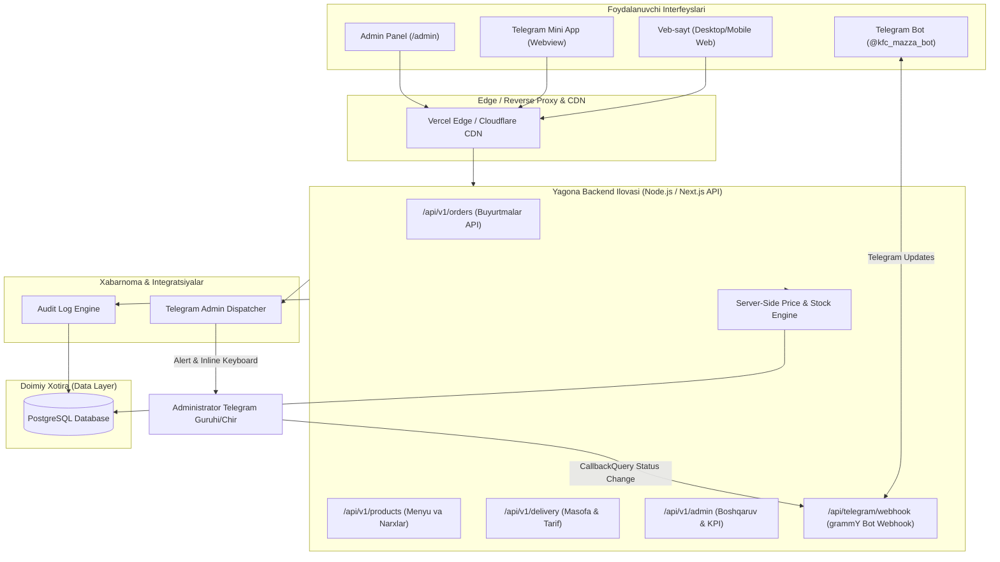
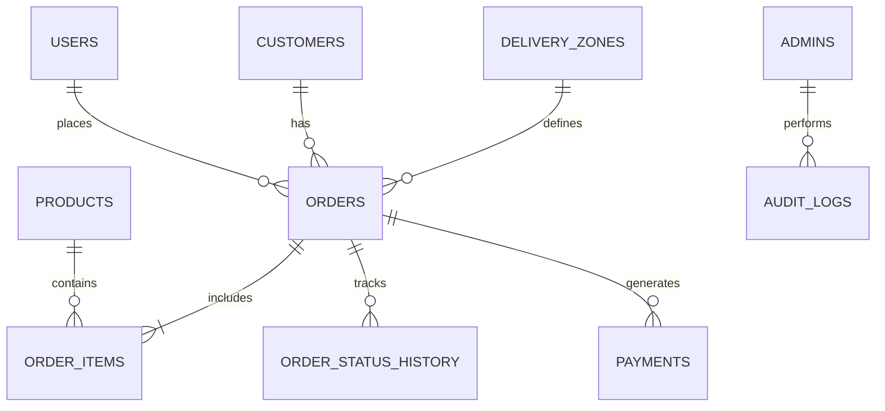

# TEXNIK VAZIFA (PRD & TZ) — PREMIUM 3D FRIED CHICKEN SAVDO PLATFORMASI

**Loyiha kodi:** `CRISPY-ANDIJON`  
**Hujjat turi:** Product Requirements Document (PRD) & Texnik Vazifa (TZ)  
**Versiya:** 1.0.0 (Production Architecture)  
**Sana:** 2026-11-03  
**Status:** Tasdiqlangan / Amalga oshirishga tayyor  
**Muallif:** Lead System Architect & Product Engineering Team  

---

## 1. LOYIHA UMUMIY TAVSIFI VA BIZNES MAQSADLARI

### 1.1. Muammo va Kontekst
Andijon viloyati va tumanida fast-food va qarsildoq tovuq (crispy chicken) bozorida yuqori talab mavjud bo'lsa-da, aksariyat savdo nuqtalari quyidagi muammolarga duch kelmoqda:
- Faqatgina telefon yoki oddiy Telegram chatlari orqali buyurtma qabul qilinishi (operator xatolari, kechikishlar, buyurtma yo'qolishi).
- Sayt, bot va savdo nuqtasi buyurtmalarining tarqoqligi (bitta markazlashgan ombor va hisob-kitob yo'qligi).
- Standart, zerikarli va ishonchsiz dizaynlar (iste'molchiga taomning haqiqiy qarsildoq va ishtahaochar sifatini his qildirib bera olmaslik).
- Ehson, oilaviy yig'inlar va to'ylar uchun katta hajmdagi (kilogrammli) oldindan buyurtma berish jarayonining avtomatlashmaganligi.

### 1.2. Loyihaning Asosiy Maqsadi
Andijon tumanidagi mijozlar uchun dunyo darajasidagi premium vizual tajribaga ega (3D interaktivlik, qora/oltin-qarsildoq ranglar balansi), o'ta tez ishlovchi, barcha savdo kanallarini (Veb-sayt, Telegram Bot, Telegram Mini App) yagona backend va PostgreSQL ma'lumotlar bazasida birlashtiruvchi to'liq avtomatlashgan savdo ekotizimini yaratish.

### 1.3. Asosiy Auditoriya (Target Audience)
1. **Kechki vaqtda uyiga qaytayotgan erkaklar:** Tezkor olib ketish (Pickup) yoki uyga qarsildoq kechki ovqat yetkazishni xohlovchilar.
2. **Ayollar va oila bekalari:** Oila a'zolari va bolalar uchun toza, sifatli, tayyor shirin yoki achchiq tovuq buyurtma qiluvchilar.
3. **Katta tadbir va ehson tashkilotchilari:** 10 kg dan 50+ kg gacha to'y, ma'raka, iftorlik yoki do'stlar yig'ini uchun oldindan aniq vaqtga buyurtma beruvchilar.

### 1.4. Mahsulotlar va Boshlang'ich Narx siyosati
- **Sweet Crispy Chicken** (Shirin nozik marinad, qarsildoq non talqoni).
- **Spicy Crispy Chicken** (Achchiq olovli marinad, qarsildoq non talqoni).
- **Baza narxi:** 1 kg tayyor tovuq = **80 000 UZS** (Admin paneldan o'zgartiriladi).
- **O'lchov birligi:** Kilogramm (1 kg, 1.5 kg, 2 kg va h.k.).

---

## 2. TEXNOLOGIK STACK VA TANLOV ASOSI

| Qatlam | Texnologiya | Tanlov Sababi (Justification) |
| :--- | :--- | :--- |
| **Frontend Framework** | **Next.js 15 (App Router, React 19)** | Server-Side Rendering (SSR), SEO afzalligi, API routes, App Router optimalligi va o'ta yuqori ishlash tezligi. |
| **Til** | **TypeScript (Strict Mode)** | To'liq type-safety, buyurtma obyektlari va narxlar kalkulyatsiyasida xatoliklarni 0 ga tushirish. |
| **Styling & UI** | **Tailwind CSS + Lucide Icons** | Yuqori moslashuvchanlik, minimal CSS bundle hajmi, zamonaviy dizayn tokenlari. |
| **3D Engine** | **Three.js + React Three Fiber (@react-three/fiber, @react-three/drei)** | Deklarativ 3D rendering, canvas optimizatsiyasi, WebGL resurslarini avtomatik tozalash va mobile-fallback mexanizmi. |
| **Animatsiyalar** | **Framer Motion** | 60fps silliq sahifa o'tishlari, savat drawer va micro-interactionlar. |
| **Backend & API** | **Next.js Route Handlers / Node.js** | Veb-sayt va Telegram Bot uchun yagona REST API arxitekturasi, kam latency. |
| **Database & ORM** | **PostgreSQL + Prisma ORM** | ACID tranzaksiyalar, relatsion jadvallar butunligi, avtomatik migratsiyalar va type-safe SQL querylar. |
| **Telegram Bot Engine** | **grammY (TypeScript)** | Zamonaviy, xotira tejamkor, Webhook va Inline Keyboardlarni o'ta yuqori tezlikda qayta ishlovchi kutubxona. |
| **State Management** | **Zustand** | Yengil, boilerplate-siz, LocalStorage bilan sinxronlashuvchi mijoz savatchasi (Cart State). |
| **Validation** | **Zod** | Server va client tomonida yagona schema orqali barcha kiruvchi ma'lumotlarni qat'iy sanitizatsiya qilish. |
| **Xarita & Geolocation**| **Leaflet / OpenStreetMap + Nominatim Geocoding** | Litsenziya xarajatlarisiz aniq xarita pin-tanlash, masofa (Haversine formula) hisoblash. |

---

## 3. TIZIM ARXITEKTURASI VA MA'LUMOTLAR OQIMI

### 3.1. High-Level Tizim Arxitekturasi (C4 Container Diagram)



### 3.2. Yagona Buyurtma Oqimi va Sinxronizatsiya Qoidasi (Unified Order Flow)

Har qanday kanal (Sayt, Bot, Mini App) orqali kelgan buyurtma quyidagi qat'iy zanjirdan o'tadi:
1. **Mijoz tanlovi:** Mahsulot turi (Shirin/Achchiq), og'irligi (kg), buyurtma turi (Pickup/Delivery/Event), manzil va telefon.
2. **Server-Side Validation:** Server mahsulotning ayni paytdagi bazadagi narxini tekshiradi, yetkazib berish masofasini koordinatalar bo'yicha hisoblaydi va yakuniy summani shakllantiradi.
3. **Database Transaction:** PostgreSQL-da bitta tranzaksiya ichida `orders`, `order_items` va `order_status_history` yozuvlari yaratiladi.
4. **Idempotency Check:** Takroriy bosishlar yoki webhook qayta yuborilishining oldi olinadi (`idempotency_key` orqali).
5. **Instant Admin Notification:** Telegram guruhiga darhol boyitilgan xabar va buyurtma statusini boshqaruvchi **Inline Tugmalar** boradi.
6. **Mijozni xabardor qilish:** Mijozga SMS/Telegram orqali buyurtma qabul qilinganligi va kuzatuv havolasi (`/track?order=ORDER-XXXXX`) taqdim etiladi.

---

## 4. MA'LUMOTLAR BAZASI SCHEMA DESIGN (POSTGRESQL & PRISMA)

### 4.1. Entity-Relationship (ER) Diagrammasi



### 4.2. Prisma Schema Fayli (`prisma/schema.prisma`)

```prisma
datasource db {
  provider = "postgresql"
  url      = env("DATABASE_URL")
}

generator client {
  provider = "prisma-client-js"
}

enum OrderType {
  PICKUP
  DELIVERY
  EVENT
}

enum OrderStatus {
  NEW
  CONFIRMED
  PREPARING
  READY
  OUT_FOR_DELIVERY
  DELIVERED
  CANCELLED
}

enum PaymentMethod {
  CASH
  OPERATOR_CONFIRMED
  CLICK
  PAYME
}

enum PaymentStatus {
  PENDING
  PAID
  FAILED
  REFUNDED
}

enum AdminRole {
  SUPER_ADMIN
  MANAGER
  OPERATOR
}

model Admin {
  id           String      @id @default(uuid())
  username     String      @unique
  passwordHash String
  fullName     String
  role         AdminRole   @default(OPERATOR)
  isActive     Boolean     @default(true)
  createdAt    DateTime    @default(now())
  updatedAt    DateTime    @updatedAt
  auditLogs    AuditLog[]

  @@map("admins")
}

model Customer {
  id             String    @id @default(uuid())
  phoneNumber    String    @unique
  fullName       String
  telegramChatId BigInt?   @unique
  createdAt      DateTime  @default(now())
  updatedAt      DateTime  @updatedAt
  orders         Order[]

  @@index([phoneNumber])
  @@map("customers")
}

model Product {
  id          String      @id @default(uuid())
  slug        String      @unique
  nameUz      String
  nameRu      String?
  description String
  basePricePerKg Decimal  @db.Decimal(12, 2)
  isSpicy     Boolean     @default(false)
  isAvailable Boolean     @default(true)
  imageUrl    String
  model3dUrl  String?
  sortOrder   Int         @default(0)
  createdAt   DateTime    @default(now())
  updatedAt   DateTime    @updatedAt
  orderItems  OrderItem[]

  @@map("products")
}

model Order {
  id                 String               @id @default(uuid())
  orderNumber        String               @unique // Masalan: #ORD-2026-0001
  customerId         String
  customer           Customer             @relation(fields: [customerId], references: [id])
  orderType          OrderType            @default(DELIVERY)
  status             OrderStatus          @default(NEW)
  paymentMethod      PaymentMethod        @default(CASH)
  paymentStatus      PaymentStatus        @default(PENDING)
  
  // Moliyaviy hisob-kitoblar (Doimo serverda hisoblanadi)
  itemsTotal         Decimal              @db.Decimal(12, 2)
  deliveryFee        Decimal              @default(0.00) @db.Decimal(12, 2)
  discountAmount     Decimal              @default(0.00) @db.Decimal(12, 2)
  grandTotal         Decimal              @db.Decimal(12, 2)
  totalWeightKg      Decimal              @db.Decimal(6, 2)

  // Yetkazish va lokatsiya
  deliveryAddress    String?
  deliveryLatitude   Float?
  deliveryLongitude  Float?
  distanceKm         Float?
  
  // Tadbir/Ehson qo'shimcha parametrlari
  eventDate          DateTime?
  guestCount         Int?
  customerNotes      String?
  operatorNotes      String?
  
  // Metadata & Idempotency
  sourceChannel      String               @default("WEB") // WEB, TELEGRAM_BOT, TELEGRAM_MINI_APP
  idempotencyKey     String?              @unique

  createdAt          DateTime             @default(now())
  updatedAt          DateTime             @updatedAt

  items              OrderItem[]
  statusHistory      OrderStatusHistory[]
  payments           Payment[]

  @@index([orderNumber])
  @@index([status])
  @@index([createdAt])
  @@map("orders")
}

model OrderItem {
  id             String   @id @default(uuid())
  orderId        String
  order          Order    @relation(fields: [orderId], references: [id], onDelete: Cascade)
  productId      String
  product        Product  @relation(fields: [productId], references: [id])
  weightKg       Decimal  @db.Decimal(6, 2)
  unitPricePerKg Decimal  @db.Decimal(12, 2)
  totalPrice     Decimal  @db.Decimal(12, 2)
  flavorNotes    String?

  @@map("order_items")
}

model OrderStatusHistory {
  id         String      @id @default(uuid())
  orderId    String
  order      Order       @relation(fields: [orderId], references: [id], onDelete: Cascade)
  fromStatus OrderStatus?
  toStatus   OrderStatus
  changedBy  String      // "SYSTEM", "ADMIN:username", "TELEGRAM:chatId"
  comment    String?
  createdAt  DateTime    @default(now())

  @@index([orderId])
  @@map("order_status_history")
}

model DeliveryZone {
  id             String   @id @default(uuid())
  name           String
  baseDistanceKm Float    @default(1.0)
  freeWeightKg   Float    @default(10.0)
  basePrice      Decimal  @default(0.00) @db.Decimal(12, 2)
  pricePerKm     Decimal  @default(3000.00) @db.Decimal(12, 2)
  isActive       Boolean  @default(true)
  createdAt      DateTime @default(now())
  updatedAt      DateTime @updatedAt

  @@map("delivery_zones")
}

model BusinessSetting {
  id                String   @id @default("default")
  restaurantName    String   @default("KFC Mazza Andijon")
  contactPhone      String   @default("+998901234567")
  telegramUsername  String   @default("@kfc_mazza_bot")
  isOpen            Boolean  @default(true)
  openTime          String   @default("10:00")
  closeTime         String   @default("23:00")
  pickupAddressUz   String   @default("Andijon tumani, Markaziy ko'cha 15-uy")
  pickupLatitude    Float    @default(40.7821)
  pickupLongitude   Float    @default(72.3442)
  updatedAt         DateTime @updatedAt

  @@map("business_settings")
}

model AuditLog {
  id         String   @id @default(uuid())
  adminId    String?
  admin      Admin?   @relation(fields: [adminId], references: [id])
  action     String   // "PRICE_UPDATE", "STATUS_CHANGE", "PRODUCT_CREATE"
  entityType String   // "ORDER", "PRODUCT", "SETTING"
  entityId   String?
  details    Json?
  ipAddress  String?
  createdAt  DateTime @default(now())

  @@index([createdAt])
  @@map("audit_logs")
}

model Payment {
  id            String        @id @default(uuid())
  orderId       String
  order         Order         @relation(fields: [orderId], references: [id], onDelete: Cascade)
  provider      PaymentMethod
  amount        Decimal       @db.Decimal(12, 2)
  status        PaymentStatus @default(PENDING)
  transactionId String?
  payload       Json?
  createdAt     DateTime      @default(now())
  updatedAt     DateTime      @updatedAt

  @@map("payments")
}
```

---

## 5. BIZNES MANTIG'I VA KALKULYATSIYA ALGORITMLARI

### 5.1. Kilogramm va Narx Hisoblash Qoidasi
Mijoz tovuqni kilogramm ko'rinishida tanlaydi (qadam: 0.5 kg yoki 1 kg).
$$\text{Mahsulot Summasi} = \sum (\text{Vazn (kg)} \times \text{Bazaviy 1 kg narxi})$$

Serverda tekshiruv:
1. Client yuborgan narxlar butunlay e'tiborsiz qoldiriladi.
2. Server `productId` bo'yicha bazadagi ayni paytdagi `basePricePerKg` ni oladi.
3. $\text{Vazn} \times \text{Narx}$ qat'iy ravishda `Decimal` formatda hisoblanadi (float rounding muammolarini yo'qotish uchun).

### 5.2. Yetkazib Berish Narxini Hisoblash Algoritmi
Andijon tumanidagi oshxonadan mijoz manziliga bo'lgan masofa koordinatalar (Haversine formulasi) asosida aniqlanadi:

$$d = 2r \arcsin \left( \sqrt{\sin^2\left(\frac{\Delta \phi}{2}\right) + \cos(\phi_1)\cos(\phi_2)\sin^2\left(\frac{\Delta \lambda}{2}\right)} \right)$$

**Tariflash Qoidalari:**
- **Masofa $\le$ 1.0 km:** Yetkazib berish **BEPUL (0 UZS)**.
- **Masofa > 1.0 km VA Jami Buyurtma $\ge$ 10.0 kg:** Yetkazib berish **BEPUL (0 UZS)** (Ehson va katta buyurtmalarni rag'batlantirish).
- **Masofa > 1.0 km VA Jami Buyurtma < 10.0 kg:**  
  $$\text{Yetkazib berish narxi} = (\text{Masofa (km)} - 1.0) \times 3\,000\text{ UZS}$$
  *(Tarif admin panelida o'zgartirilishi mumkin. Agar manzil koordinatalari aniq bo'lmasa, "Kuryer narxi operator tomonidan belgilanadi" belgisi qo'yiladi).*

---

## 6. TELEGRAM BOT VA MINI APP (TMA) INTEGRATSIYASI

### 6.1. Telegram Bot Arxitekturasi (grammY)
- **Bot rejimi:** Production muhitida xavfsiz **Webhook** (`/api/telegram/webhook`), mahalliy ishlab chiqishda Long Polling.
- **Webhook Xavfsizligi:** `X-Telegram-Bot-Api-Secret-Token` sarlavhasi orqali har bir so'rov tekshiriladi.
- **Idempotentlik:** Telegram takroriy yuborgan `update_id` xotirada/keshda tekshirilib, dublikat buyurtma yaratilishining oldi olinadi.

### 6.2. Bot Buyurtma Zanjiri (FSM / Conversation)
```
/start
  ├── [🍗 Menyu & Buyurtma] ---> WebApp (Telegram Mini App) tugmasi / Oddiy bot menyusi
  ├── [📦 Mening buyurtmalarim] ---> Faol va o'tgan buyurtmalar ro'yxati
  ├── [🔍 Buyurtmani kuzatish] ---> Buyurtma raqamini kiritish (#ORD-XXXX)
  └── [📞 Operator bilan aloqa] ---> Administrator telefon raqami
```

### 6.3. Administrator Xabarnomasi va Interaktiv Inline Boshqaruv
Saytdan yoki botdan buyurtma tushgan lahzada Telegram admin guruhiga quyidagi formatda to'liq xabar jo'natiladi:

```text
🔔 YANGI BUYURTMA: #ORD-2026-0042
━━━━━━━━━━━━━━━━━━
👤 Mijoz: Alisher Karimov
📞 Tel: +998 91 123 45 67
🛵 Buyurtma turi: Yetkazib berish (Delivery)
📍 Manzil: Andijon t., Bog'i Shamol MFY, 12-uy
🧭 Masofa: 3.4 km

📦 MAHSULOTLAR:
• Sweet Crispy Chicken — 3.0 kg (240 000 UZS)
• Spicy Crispy Chicken — 2.0 kg (160 000 UZS)

💰 Moliyaviy hisob:
• Mahsulotlar: 400 000 UZS
• Yetkazib berish: 7 200 UZS
• JAMI: 407 200 UZS
💳 To'lov turi: Naqd pul (Qabul qilinganda)
━━━━━━━━━━━━━━━━━━
Holat: 🟡 Yangi buyurtma
```

**Telegram Inline Tugmalar Matritsasi:**
```
[ ✅ Tasdiqlash ]  [ 👨‍🍳 Tayyorlanmoqda ]
[ 🍗 Tayyor ]      [ 🛵 Kuryerga berildi ]
[ ✨ Yakunlandi ]  [ ❌ Bekor qilish ]
```
Administrator istalgan tugmani bosganda:
1. `callback_query` backendga keladi.
2. Bazadagi `Order.status` va `OrderStatusHistory` yangilanadi.
3. Telegram xabaridagi status matni va tugmalar yangilanadi.
4. Mijoz veb-saytidagi kuzatuv sahifasida progress real vaqtda o'zgaradi.
5. Agar mijoz Telegram orqali ro'yxatdan o'tgan bo'lsa, unga darhol: *"Sizning #ORD-2026-0042 buyurtmangiz tayyorlanishga topshirildi!"* xabari yuboriladi.

---

## 7. 3D WEB TAJRIBASI VA FRONTEND DIZAYN TIZIMI

### 7.1. Vizual Identifikatsiya (Design System)
- **Asosiy Fon:** Deep Charcoal / Obsidian Black (`#0B0C0E`, `#131418`).
- **Matn Rangi:** Warm Ivory / Soft Cream (`#F7F7F2`, `#E2E2DC`).
- **Urg'u Ranglari (Accents):** Crispy Golden Orange (`#FF7A00`), Spicy Fire Red (`#E53935`), Warm Amber Gold (`#F59E0B`).
- **Sirtlar va Kartalar:** Qora shisha effekti (Glassmorphism: `rgba(255, 255, 255, 0.04)`, `backdrop-blur-md`, chegara: `1px solid rgba(255,255,255,0.08)`).

### 7.2. 3D Hero Pipeline (Three.js / React Three Fiber)
1. **Model Format:** Optimallashtirilgan `.glb` formati, DRACO siqish algoritmi bilan (fayl hajmi < 1.8 MB).
2. **Kamera & Yoritish:** Studio 3-nuqtali yoritish (Key Light, Rim Light — qarsildoq fakturani ajratib ko'rsatish uchun tillarang yorug'lik, Fill Light).
3. **Interaktivlik:**
   - Sichqoncha harakati bo'yicha yumshoq Parallax (lerp amortizatsiyasi).
   - Past tezlikdagi uzluksiz aylanish (idle rotation).
   - Scroll bo'yicha 3D model orientatsiyasining o'zgarishi.
4. **Mobile & Low-End Fallback:**
   - Agar WebGL qo'llab-quvvatlanmasa yoki qurilma xotirasi kam bo'lsa, 3D Canvas o'rniga fotorealistik WebP rasm ko'rsatiladi.
   - `prefers-reduced-motion` holatida harakat to'xtatiladi.

---

## 8. FOYDALANUVCHI INTERFEYSI VA SAHIFALAR STRUKTURASI

1. **Sahifa 01 — Asosiy Sahifa (Home / Hero):**
   - Premium sticky navbar (Logo, Menyu, Savat indikatori, Aloqa).
   - 3D Hero Section ("MAZALI LAHZA. QARSILDOQ TA'M").
   - Savdo afzalliklari (Haqiqiy go'sht, maxsus marinad, issiq yetkazish).
   - Ommabop taomlar ro'yxati va Tezkor buyurtma CTA.
2. **Sahifa 02 — Menyu (Menu Catalog):**
   - Shirin va Achchiq tovuq filtrlari.
   - Interaktiv vazn selektori (1 kg, 1.5 kg, 2 kg, 3 kg...).
   - Narxning dinamik o'zgarishi va savatchaga animatsiya bilan qo'shilishi.
3. **Sahifa 03 — Mahsulot Tafsiloti (Product Detail):**
   - 3D model ko'rinishi / Katta fotorealistik galereya.
   - Tarkibi, marinad siri, tayyorlanish vaqti.
   - Tavsiya etiladigan souslar va ichimliklar (Upsell).
4. **Sahifa 04 — Savatcha (Cart Drawer / Page):**
   - Tanlangan tovuqlar va kilogrammlar.
   - Vazn bo'yicha umumiy hisob.
   - Bepul yetkazib berishgacha qolgan kilogramm indikatori ("Yana 4 kg qo'shing va bepul yetkazishga ega bo'ling!").
5. **Sahifa 05 — Checkout (Buyurtmani Rasmiylashtirish):**
   - 3 ta tab: **Olib ketish (Pickup)** / **Yetkazib berish (Delivery)** / **Ehson va Tadbir (Event)**.
   - Ism va Telefon raqami (avtomatik +998 maskasi).
   - Xaritadan manzilni belgilash yoki kiritish.
   - To'lov usuli (Naqd / Operator bilan kelishuv / Payme-Click tayyorgarligi).
6. **Sahifa 06 — Buyurtmani Kuzatish (Live Order Tracking):**
   - Progress bar (Qabul qilindi -> Oshxonada -> Tayyor -> Kuryer yo'lda -> Yetkazildi).
   - Kuryer/Operator bilan to'g'ridan-to'g'ri bog'lanish tugmasi.
7. **Sahifa 07 — Ehson va Katta Tadbirlar (Bulk & Event Orders):**
   - Mehmonlar soni kalkulyatori (Masalan: 50 kishiga qancha kg tovuq kerakligini hisoblab beruvchi aqlli slayd).
   - Tadbir sanasi va aniq vaqtini tanlash.
   - To'g'ridan-to'g'ri bosh menejerga yuboriluvchi alohida prioritetli kanal.
8. **Sahifa 08 — Biz haqimizda & Aloqa (About & Locations):**
   - Andijon tumanidagi oshxonaning aniq xaritasi, ish vaqti, gigiyena va sifat kafolatlari.

---

## 9. ADMIN PANEL (BOSHQARUV PANELI)

`/admin` marshruti orqali kiruvchi to'liq boshqaruv tizimi:
1. **Analitika & KPI Dashboard:**
   - Bugungi tushum (UZS), Sotilgan jami kilogramm (kg), Buyurtmalar soni.
   - Shirin vs Achchiq tovuq nisbati (Diagramma).
   - Delivery vs Pickup buyurtmalar statistikasi.
2. **Buyurtmalar Boshqaruvi (Orders Kanban & Table):**
   - Barcha kanallardan (Sayt, Bot, Mini App) tushgan buyurtmalar bitta joyda.
   - Bir klik bilan statusni o'zgartirish va mijozga avtomatik SMS/Telegram xabar yuborish.
3. **Mahsulot va Narx Sozlamalari (Catalog & Pricing):**
   - 1 kg narxini bir zumda yangilash.
   - Mahsulot zaxirasini boshqarish ("Stokda bor" / "Tugadi" statusi).
4. **Yetkazib berish zonalari va ish vaqti:**
   - Ish vaqtini ochish/yopish (bir klik bilan saytda "Hozir oshxona yopiq, buyurtmalar 10:00 dan qabul qilinadi" xabari chiqadi).
   - Kilometr tariflari va bepul yetkazish chegaralari.
5. **Audit Logs (Xavfsizlik Jurnali):**
   - Kim qaysi narxni qachon o'zgartirdi, qaysi buyurtma kim tomonidan bekor qilindi.

---

## 10. XAVFSIZLIK VA ISHLASH TEZLIGI (PERFORMANCE & SECURITY)

### 10.1. Xavfsizlik Talablari
- **Secrets Isolation:** Telegram Bot Token, Webhook Secret, Database Paroli faqat `.env` faylida saqlanadi va frontend bundle'ga aslo kiritilmaydi.
- **Server-Side Price Integrity:** Narx hech qachon brauzerdan olinmaydi. Barcha yakuniy summalar PostgreSQL bazasidagi qiymatlar bo'yicha hisoblanadi.
- **Rate Limiting:** API endpointlari (ayniqsa `/api/v1/orders`) DDOS va spam buyurtmalardan himoya qilish uchun IP bo'yicha cheklanadi.
- **Authentication:** Admin paneli `argon2` / `bcrypt` bilan shifrlangan parollar va xavfsiz HTTP-Only cookies/JWT sessiyalari orqali himoyalanadi.

### 10.2. Performance Budjeti (Lighthouse 90+)
- **LCP (Largest Contentful Paint):** $\le$ 2.5 soniya.
- **CLS (Cumulative Layout Shift):** $\le$ 0.05 (3D Canvas yuklanishida skelet va qat'iy konteyner o'lchamlari).
- **INP (Interaction to Next Paint):** $\le$ 150 ms.
- **Rasmlar:** WebP/AVIF formatlari, `next/image` yordamida responsive o'lchamlarda yuklanadi.
- **3D yuklanishi:** Asosiy sahifa yuklangandan keyin lazy-load qilinadi; foydalanuvchiga darhol poster tasvir namoyish etiladi.

---

## 11. BOSQICHMA-BOSQICH AMALGA OSHIRISH REJASI (ROADMAP)

```
1. [Loyiha Asosi & DB] → verify: Prisma migratsiyalari va PostgreSQL ulanishi muvaffaqiyatli
2. [Design System & 3D Hero] → verify: 3D tovuq modeli, ranglar va UI komponentlar 60fps render
3. [Menyu, Savat & Checkout] → verify: Kilogramm tanlash, savat va server narx validatsiyasi
4. [Telegram Bot & Webhook] → verify: /start, buyurtma olish va Admin guruhiga tugmali xabar tushishi
5. [Admin Dashboard] → verify: Buyurtmalar jadvali, narx o'zgartirish va status boshqaruvi
6. [E2E Testing & Optimization] → verify: Barcha 3 kanal orqali test buyurtmalar va Lighthouse 90+ audit
```

---

## 12. XULOSA VA KEYINGI QADAMLAR

Ushbu PRD-TZ talablari asosida arxitektura to'liq shakllantirildi. Loyiha faqat "vizual qobiq" bo'lmasdan, Andijon bozorida real pul aylanmasini ta'minlovchi, mustahkam, xavfsiz va kengayuvchan korxona darajasidagi savdo tizimiga aylanadi.
